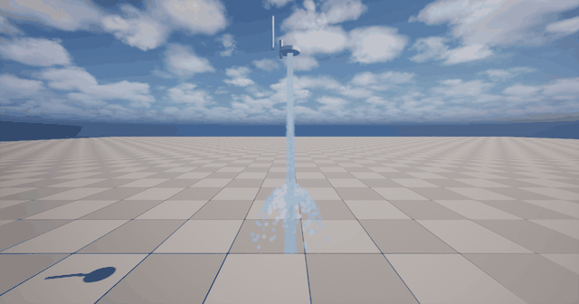
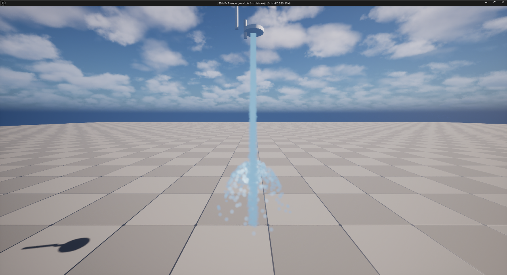
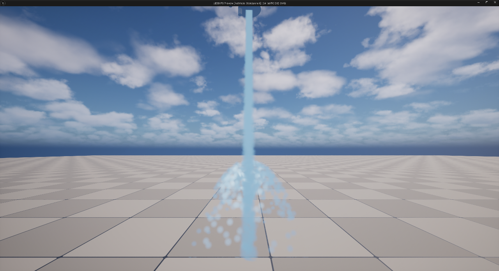

# WaterFaucet

Water faucet VFX for **Unreal Engine 5.8** — a Niagara-based water jet with splash droplets,
and a lit translucent water material with adjustable **colour, transparency, metallic,
roughness and specular**.

A content-only package: no plugin, no C++ module. Copy the assets into your project and use them.

English | [Русская версия](README.ru.md)



*The GIF is recorded in PIE at roughly 2× real-time speed.*

| Whole scene | Droplets close-up |
| --- | --- |
|  |  |

## Requirements

| Item | Value |
| --- | --- |
| Engine | **Unreal Engine 5.8** (assets are saved in the 5.8 format and will not open in older versions) |
| Plugin | **Niagara** (enabled by default) |
| RHI | DX12 / Shader Model 6 recommended (Lumen). `Config/DefaultEngine.ini` sets `r.AllowStaticLighting=False` |
| Project type | Content-only — **no plugin and no C++ module required** |

## Contents

All assets live in the `/Game/VFX` folder.

| Asset | Type | Purpose |
| --- | --- | --- |
| `NS_Shower` | Niagara System | The effect. Two emitters: **Stream** (the jet) and **Splash** (droplets at the impact point) |
| `M_Water` | Material | Water sprite material: round droplet mask, Default Lit + translucent, exposes `Color`, `Opacity`, `Metallic`, `Roughness`, `Specular`, `Brightness` |
| `MI_Water` | Material Instance | Default preset — light blue, translucent, non-metallic |
| `MI_Water_Metallic` | Material Instance | Alternate preset — grey, fully metallic (mirror-like look) |
| `BP_ShowerHead` | Blueprint | Faucet head actor: mesh + Niagara component, exposes the tuning properties |
| `L_ShowerDemo` | Level | Demo scene with sky, sun and a ground plane |

## Installation

The material is **Default Lit**, so it needs light: a directional light + sky light (or a sky
atmosphere) in your level. Reflections come from the scene.

### Option A — copy the folder (fastest)

1. Copy `Content/VFX` into `<YourProject>/Content/VFX`.
2. Keep the path `/Game/VFX/...` — the assets reference each other by that path.
3. Restart the editor (or press "Refresh" in the Content Browser).

### Option B — migrate from the demo project (safe, resolves dependencies)

1. Open `WaterFaucet.uproject` with UE 5.8.
2. In the Content Browser select the `Content/VFX` folder.
3. Right-click → **Asset Actions → Migrate…** → confirm the asset list → choose
   `<YourProject>/Content`.
4. The assets land in `<YourProject>/Content/VFX`.

### Then

Drag **`BP_ShowerHead`** into your level and press Play, or add `NS_Shower` to a Niagara
component yourself. The impact plane sits `User.FallHeight` cm below the head — move the actor
up/down or change that value to match your floor.

## Usage

### `BP_ShowerHead` properties (Details panel, category **Shower**)

| Property | Default | Meaning |
| --- | --- | --- |
| `Enabled` | `true` | Turns the Niagara component on/off (the faucet "tap") |
| `Speed` | `600` | Jet speed, cm/s |
| `DropIntensity` | `1200` | Splash droplet count |
| `DropSize` | `6` | Splash droplet size |
| `WaterMaterial` | `MI_Water` | Material for the sprites (see *Known limitations*) |

The values are applied by the actor's Construction Script to the Niagara user parameters below.

### `NS_Shower` user parameters

| Parameter | Default | Meaning |
| --- | --- | --- |
| `User.Pressure` | `1` | Flow-rate / jet-speed multiplier (drives both emitters) |
| `User.Speed` | `600` | Jet speed, cm/s |
| `User.SprayAngle` | `6` | Spray cone angle, degrees |
| `User.SprayRadius` | `6` | Jet radius, cm |
| `User.FallHeight` | `200` | Distance from the head down to the impact plane, cm |
| `User.DropIntensity` | `1800` | Splash droplets per second |
| `User.DropSize` | `8` | Splash droplet sprite size |
| `User.WaterMaterial` | `MI_Water` | Water material (see *Known limitations*) |

### Water material parameters (`MI_Water`)

Open `MI_Water` (or `MI_Water_Metallic`) and edit the values in the Details panel.

| Parameter | `MI_Water` | `MI_Water_Metallic` | Meaning |
| --- | --- | --- | --- |
| `Color` | `0.50 / 0.70 / 0.85` | `0.85 / 0.85 / 0.85` | Base colour of the water |
| `Opacity` | `0.6` | `0.65` | Transparency (`0` = invisible, `1` = opaque) |
| `Metallic` | `0.0` | `1.0` | Metallic look — tints reflections with the base colour |
| `Roughness` | `0.05` | `0.08` | `0.02` = glassy mirror highlights, `0.5` = matte |
| `Specular` | `0.8` | `0.6` | Highlight intensity on non-metallic surfaces |
| `Brightness` | `0.4` | `0.6` | Emissive tint so the water stays readable in shadow |

Quick recipes:

* glassy / crystal water — `Roughness` `0.02`, `Metallic` `0.1`, `Opacity` `0.5`
* more transparent — `Opacity` `0.35`, `Brightness` `0.2`
* milk / foam — `Opacity` `1.0`, `Roughness` `0.4`, `Metallic` `0.0`
* liquid metal — `Metallic` `1.0`, `Roughness` `0.05` (see `MI_Water_Metallic`)

## How it works

* **Stream emitter** — velocity-aligned sprites shot downwards from the head, with curl noise
  for wobble and a drag force; the sprite size, cone angle and radius are driven by the user
  parameters.
* **Splash emitter** — spawns droplets at the impact point (`User.FallHeight` below the head),
  bursts them outwards with gravity and drag, sizes them with `User.DropSize` and fades alpha
  with `1 - NormalizedAge`.
* **Droplet shape** — `M_Water` has no texture: a `SphereMask` built from the sprite UVs creates
  the round alpha mask, and the same value multiplies into `Opacity`. That is why the particles
  read as round droplets instead of squares.
* **Rendering** — translucent, two-sided, Default Lit so the sprites receive real lighting,
  specular highlights and (with Lumen) reflections.

## Known limitations

* **Changing the material per actor.** The `WaterMaterial` property on `BP_ShowerHead` (and the
  `User.WaterMaterial` parameter) is bound to the renderer through Niagara's "Material User
  Parameter". The binding saved in this package has a stale type handle, so a freshly assigned
  material is ignored until you re-pick `User.WaterMaterial` once in the **Material User
  Parameter** dropdown of the sprite renderer in the Niagara editor. Until then the renderer
  keeps `MI_Water`. The reliable way to change the look today is to edit / swap the
  **material instance**.
* **Niagara does not tick in the editor viewport** — check the effect with **Play (PIE)**.
* The demo level is authored with `r.AllowStaticLighting=False` (Lumen). Under baked/static
  lighting the water will look different.

## Repository layout

```
WaterFaucet.uproject
Config/DefaultEngine.ini          # start map, Lumen / DX12 settings
Content/VFX/NS_Shower.uasset      # the Niagara system
Content/VFX/M_Water.uasset        # water material
Content/VFX/MI_Water.uasset       # default (blue, translucent)
Content/VFX/MI_Water_Metallic.uasset
Content/VFX/BP_ShowerHead.uasset  # faucet head actor
Content/VFX/L_ShowerDemo.umap     # demo level
Docs/                             # screenshots and GIF used in this README
```
